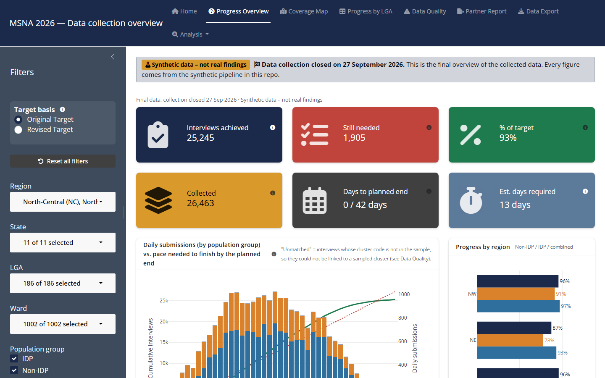
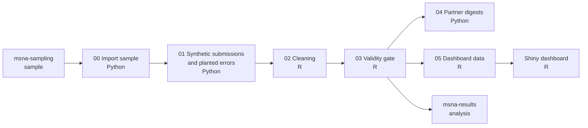
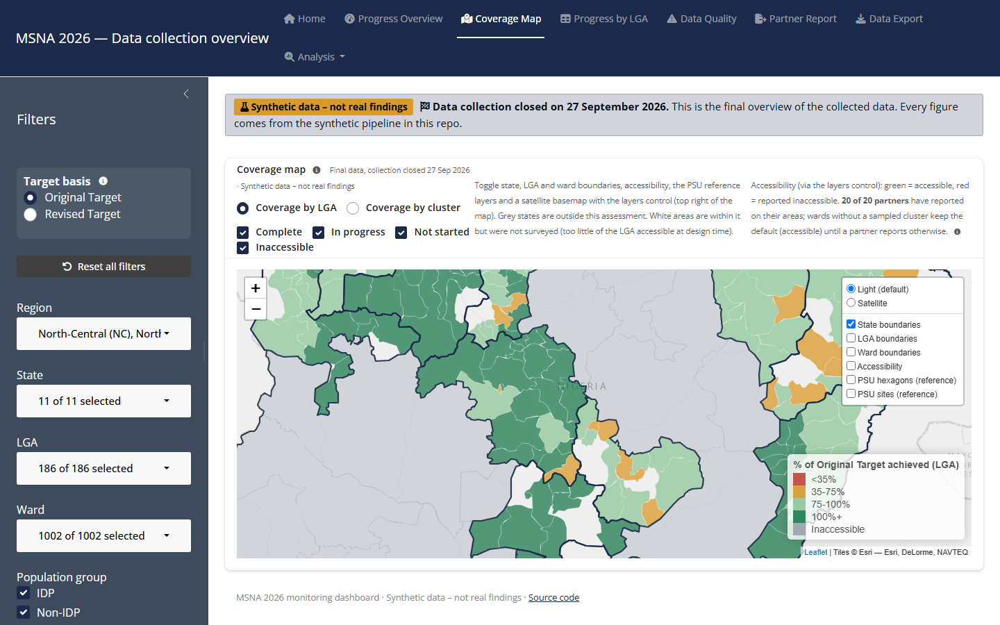

# MSNA monitoring

Stages 2 and 3 of the [MSNA pipeline](https://github.com/JackPhilpott/msna-pipeline): watching data
collection as it happens, cleaning the data, and checking it is fit for analysis.

This is a public, runnable version of the monitoring I built for the 2026 northern Nigeria
Multi-Sector Needs Assessment (MSNA). The real survey covers 32,000 households across 11 states and
176 local government areas (LGAs). It runs with 20+ partner organisations, at up to 1,000
submissions a day. At that pace, problems have to be caught within days, not after collection
ends: interviews that are too short, GPS points far from the household, duplicates, implausible
answers, and enumerators whose interviews all look the same. Each partner needs to know what to
follow up, and the team needs to see progress against target in every LGA. This repo runs the same
workflow on six weeks of synthetic submissions, from the sample drawn in
[`msna-sampling`](https://github.com/JackPhilpott/msna-sampling) to a clean dataset ready for
analysis. Its dashboard is the one used on the real survey, ported onto the synthetic data.

**[Live dashboard demo](https://jackphilpott.shinyapps.io/msna-monitoring/)**



## What it does

| Step | Result in the demo run |
| :- | :- |
| Fieldwork | 27,087 submissions from 4,269 clusters over 42 days, by 404 enumerators in teams of two from 20 partners, peaking at 1,063 a day |
| Cleaning | 14 checks: 1,842 interviews removed, 340 values corrected, 1,821 interviews flagged for follow-up |
| Planted errors | All 3,093 caught, each with the expected action (remove, change or flag) |
| Validity gate | 10 checks pass; 1 warning (4 of 300 strata below 80% of target) |
| Partner digests | One data-quality workbook per partner |
| Dashboard | Ten pages, with filters for region, state, LGA, ward, population group, partner and date, and a switch between the original and revised targets |

## How it works

The pipeline alternates between R and Python. Each step reads the previous step's output from
`data/synthetic/`.



**Questionnaire.** A reduced MSNA-style questionnaire with about 50 questions, built from standard
public indicators, is kept as an XLSForm in [`questionnaire/`](questionnaire/) (readable as CSV):
- the respondent and household: age, gender, household size and composition, displacement
- the Food Consumption Score (FCS)
- the reduced Coping Strategies Index (rCSI)
- the Household Hunger Scale (HHS)
- livelihood coping strategies (LCSI)
- water, sanitation, shelter, health, education, income, assistance and priority needs

**Synthetic submissions.** Each partner fields teams of two enumerators in proportion to its
workload. Each team starts in the first fortnight, visits about one cluster a day with rest days,
and picks up replacement clusters once partners' access reports have them drawn. In a cluster, the
team interviews the primary households and moves to reserves when a household is absent or
declines, working through the day from mid-morning. Answers follow plausible patterns: food
consumption, coping and hunger move together, and IDP households are worse off on average. State
and LGA differences are random draws, so nothing here reflects real conditions. A few enumerators
round ages to the nearest five, as happens in real surveys. Half the partners follow up: their teams
reach every cluster, go back to replace each interview that cleaning will delete with an unused
reserve household, and make up for clusters lost to access with extra reserve households elsewhere
in the stratum. The export looks like a Kobo download. Errors are then planted, and each one is
recorded in an answer key with the action cleaning should take.

**Cleaning.** Fourteen checks, in the families used on the real survey:
- consent
- duplicate submissions and households
- interview length
- cluster codes that are not in the sample, or were reported inaccessible
- GPS distance from the household
- flat or contradictory food-security answers
- outliers and impossible household compositions
- "other" answers that match an existing option
- enumerator patterns

Each finding goes into a cleaning log as remove, change or flag, following the same cleaning-log and
deletion-log approach as the open-source
[`cleaningtools`](https://github.com/impact-initiatives/cleaningtools) R package. The clean data then
gets the standard food-security composites.

**How well cleaning works.** Because the errors are planted, every check can be scored. All 3,093
are caught, each with the expected action. A perfect catch rate is expected when the checks and the
errors are designed together, and real data is messier. The more telling number is the 302 flags on
records with no planted error. Those are genuine households with an unusual profile (acceptable food
consumption but severe hunger), which is exactly what a follow-up flag is for.

**Validity gate.** Before the data goes to analysis, 11 checks confirm it holds together across
stages. For example:
- every submission is either kept or in the deletion log
- every interview is in an active cluster, with a household from that cluster's list
- no cluster has more interviews than households on its list (clusters go past 6 only where a partner made up for clusters lost to access)
- every change in the cleaning log is applied
- the copy of the sample matches `msna-sampling`

A failure stops the pipeline.

**Dashboard.** This is the dashboard used to monitor the real survey, ported to run on the
synthetic data. The data loading, partner names and explanatory text changed, a few features the
synthetic data cannot exercise were removed, and Data Quality shows this pipeline's check types.
The progress logic, the pages and the look are the original's. Step 5 reshapes the pipeline's
outputs into the inputs the original read. It has ten pages:
- **Home:** what the survey and the dashboard are, the key definitions, and the national picture
- **Progress Overview:** achieved and still needed, daily submissions against the pace needed,
  and every partner's progress and pace
- **Coverage Map:** progress by LGA or by cluster, with layers for boundaries, ward accessibility
  and the sampling frame's PSUs
- **Progress by LGA:** every LGA and population group against its original and revised targets
- **Data Quality:** what cleaning flagged, by type, down to the submission
- **Partner Report:** one partner's LGAs, with an Excel or PDF report to send them
- **Data Export:** whatever is in view, without respondent details
- **Analysis:** enumerator performance, data integrity checks (copied GPS points, odd hours, age
  heaping, impossible workloads) and sample representativeness

The sidebar filters by region, state, LGA, ward, population group, partner and date, and each
filter narrows the others' choices. Moving the end date back shows collection as it stood on that
day. The target switch measures everything against either the original target or the revised
one, recalculated on the population still accessible. A link such as `?page=Coverage%20Map` opens
a page directly.

Two ideas run through every page. **Collected vs. Achieved:** Collected is every completed
interview; Achieved is what counts toward the sample, after cleaning's deletions. A flag for
follow-up does not remove an interview until it is confirmed. **Credited progress:** interviews
past a stratum's own target count as Achieved, but percentages cap each stratum at its target, so
a surplus in one LGA never hides a shortfall in another.



## Quick start

You need R (4.4 or later) and Python (3.11 or later).

```bash
git clone https://github.com/JackPhilpott/msna-monitoring.git
cd msna-monitoring
Rscript -e "renv::restore()"                 # renv installs itself on first start
python -m venv .venv
.venv/bin/pip install -r requirements.txt    # Windows: .venv\Scripts\pip install -r requirements.txt
.venv/bin/python run_all.py                  # Windows: .venv\Scripts\python run_all.py
Rscript -e "shiny::runApp('dashboard_app')"
```

The pipeline takes about two minutes. Step 0 copies the sample from a sibling `msna-sampling`
checkout if there is one, and otherwise downloads it from GitHub. Step 5 does the same with the
COD-AB boundaries (a 10 MB download). The seed is fixed, so every run gives byte-identical outputs.
All settings are in `config.yml`, including the collection period, the team workload, the error
rates and the cleaning thresholds.

To run the tests:

```bash
Rscript -e "testthat::test_dir('tests/testthat')"
.venv/bin/python -m pytest tests/python
```

## Outputs

Everything in `data/synthetic/` is committed. The next stage, `msna-results`, copies the clean
data into `data/synthetic/from_monitoring/`.

| File | What it holds |
| :- | :- |
| `from_sampling/` | The sample, copied from `msna-sampling` |
| `raw/submissions_<state>.csv.gz` | The raw export, one file per state |
| `raw/answer_key.csv` | The planted errors and the action expected for each |
| `clean/clean_data_<state>.csv.gz` | The clean data, with the food-security composites |
| `clean/cleaning_log.csv` | Every finding: check, question, old and new value, action |
| `clean/deletion_log.csv` | Every removed interview and why |
| `clean/enumerator_flags.csv` | Each enumerator's interview length and answer patterns |
| `clean/check_performance.csv` | Each check scored against the answer key |
| `clean/validity_report.csv` | The validity gate's results |
| `clean/achieved_by_stratum.csv` | Households interviewed against target, per stratum |
| `partner_digests/` | One data-quality workbook per partner |
| `dashboard_app/data/` | The dashboard's inputs: submissions with cleaning's decisions, the frame, targets, accessibility and map layers |

## Data and confidentiality

No real survey data is used. That means no real submissions, sampling frames, partner details,
enumerators, IDP site names or locations, or security data. The questionnaire is built from public
indicator definitions, not copied from the real form. The sample comes from `msna-sampling`, which
uses open boundary and population data and is otherwise synthetic. Partners are "Partner A" to
"Partner T", and enumerator IDs are made up. Every dashboard page and every workbook carries the
label "Synthetic data – not real findings".

The dashboard's maps use the state and LGA boundaries from
[COD-AB Nigeria](https://data.humdata.org/dataset/cod-ab-nga) (OCHA, via HDX, licence CC BY-IGO),
simplified for the web. Wards are synthetic: each LGA is split into made-up wards, because IDP
camps are often named after the ward they are in. Ward accessibility follows the synthetic access
reports from `msna-sampling`, and is not real security information.

Before every commit, the repo is checked against a private deny-list of names, contacts, internal
paths and site names. It is also scanned for secrets with gitleaks, checked so that no file matches
a real data file, and kept to files under 2 MB.

## Part of the MSNA pipeline

| Stages | Repo | Status |
| :- | :- | :- |
| Overview | [`msna-pipeline`](https://github.com/JackPhilpott/msna-pipeline) | Live |
| 1 | [`msna-sampling`](https://github.com/JackPhilpott/msna-sampling) | Live |
| 2–3 | `msna-monitoring` (this repo) | Live |
| 4–5 | `msna-results`: analysis and reporting | Planned, mid-Nov 2026 |

---

Built with AI-assisted development, reviewed and tested by me.
